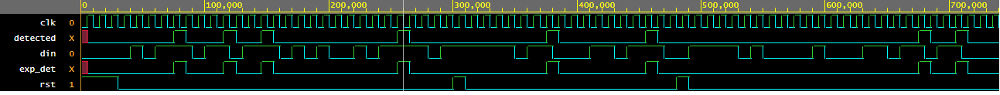

# 1011 Sequence Detector (Moore FSM) in Verilog

A serial **overlapping "1011" sequence detector** designed as a Moore finite state machine, with a **self-checking testbench** that compares the design against a reference model.

## Features
- Moore FSM with 5 states (S0-S4), synchronous active-high reset
- Detects overlapping patterns (e.g. `1011011` is detected twice)
- Self-checking testbench with directed tests and 500 random cycles (including random resets)
- Prints `RESULT: PASS` or `RESULT: FAIL` automatically

## State diagram

| State | Meaning        | din = 0 | din = 1 |
|-------|----------------|---------|---------|
| S0    | nothing matched | S0     | S1      |
| S1    | `1`            | S2      | S1      |
| S2    | `10`           | S0      | S3      |
| S3    | `101`          | S2      | S4      |
| S4    | `1011` (output = 1) | S2 | S1      |

> TODO: add a hand-drawn state diagram image to `docs/state_diagram.png`

## Project structure
```
seq-detector-1011/
├── rtl/seq_detector_1011.v      # design (DUT)
├── tb/seq_detector_1011_tb.v    # self-checking testbench
├── sim/                         # waveform screenshot goes here
├── docs/                        # state diagram goes here
└── README.md
```

## How to run

### Option 1: Icarus Verilog + GTKWave (local)
```bash
iverilog -g2012 -o sim/out rtl/seq_detector_1011.v tb/seq_detector_1011_tb.v
vvp sim/out
gtkwave sim/waveform.vcd
```

### Option 2: EDA Playground (browser, no install)
1. Paste the design file in the right panel and the testbench in the left panel.
2. Select **Icarus Verilog** and tick **Open EPWave after run**.
3. Click **Run**.

## Test plan

| # | Test | Expected |
|---|------|----------|
| 1 | `1011` | detected once |
| 2 | `1011011` (overlap) | detected twice |
| 3 | `1010`, `1001`, `0111` | no detection |
| 4 | reset in the middle of `101` | no false detection after reset |
| 5 | 500 random bits with random resets | DUT always matches reference model |

## Result
> Add your simulation output and waveform screenshot here.

Example: `Checks: ... | Errors: 0 | RESULT: PASS`

 

## What I learned
- Writing Moore FSMs in three blocks (state register, next-state logic, output logic)
- Handling overlap in sequence detection
- Building a self-checking testbench with a reference model
- Bug injection: I changed a transition on purpose and confirmed the checker reports FAIL

## Possible improvements
- Parameterize the pattern
- Add a Mealy version and compare
- Convert the testbench to SystemVerilog class-based (driver, monitor, scoreboard)
- Add assertions (SVA) and functional coverage
